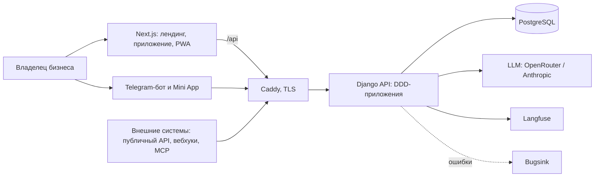

Pitch deck for OYDIN project: [OYDIN.pdf](OYDIN.pdf)
<p align="center">
  
</p>

<h1 align="center">Oydin</h1>

<p align="center">
  <b>ИИ-«второй мозг» для малого бизнеса в Узбекистане.</b><br>
  Скажите голосом или текстом, что произошло с деньгами. Oydin разложит операции и заранее покажет, хватит ли денег на обещанные платежи.
</p>

<p align="center">
  <a href="https://oydin.space">Приложение</a> ·
  <a href="https://docs.oydin.space">Документация для разработчиков</a> ·
  <a href="https://t.me/oydin_agent">Telegram-бот @oydin_agent</a>
</p>

---

## Что такое Oydin

ИП, самозанятые и микробизнес без финансиста теряют деньги на кассовых разрывах, ленятся записывать траты и путают оборот с прибылью. Oydin не просит строить отчёты: он слушает, записывает, считает и предупреждает.

Первый пилот: текстильная печать (шоурум с розницей и B2B-тиражи). Подробнее: [docs/product.md](docs/product.md).

## Возможности

- **Пульс бизнеса.** Утренняя сводка карточками: свободные деньги, отложено под платежи, сколько можно взять себе, реальная прибыль.
- **Чат и голос.** «Заплатил аренду 4 млн наличкой» превращается в черновик операции, который подтверждается одним тапом. ИИ предлагает, человек подтверждает.
- **Платёжный календарь и конверты.** Прогноз остатка по дням, дата и сумма возможного разрыва, дневной взнос на обязательства.
- **Операции.** Наличные, карта и счёт; переводы между своими счетами не считаются расходом; личное отделено от бизнеса.
- **Товары и заказы.** Цена, себестоимость, маржа; неизвестные значения помечены как допущения.
- **Инсайты.** Карточки с источником, датой и уровнем уверенности.
- **Telegram-бот и Mini App**, импорт из Excel и банков, публичный API, вебхуки и MCP.
- **RU / UZ / EN**, PWA, тёмная тема, мобильный интерфейс в первую очередь.

## Скриншоты

<p align="center">
  
  
  
  
</p>
<p align="center">
  
  
  
  
</p>

## Архитектура



Подробнее: [docs/architecture.md](docs/architecture.md), контракт API: [docs/openapi.yaml](docs/openapi.yaml).

## Стек

| Слой | Технологии |
|---|---|
| Backend | Python 3.14, Django, PostgreSQL, gunicorn, WhiteNoise |
| Web | Next.js (standalone), TypeScript, Bun, PWA |
| ИИ | OpenRouter (Gemini), запасной провайдер Anthropic, Langfuse, STT |
| Инфраструктура | Docker Compose, Caddy (авто-TLS), GitHub Actions, Bugsink |
| Инструменты | mise, uv |

## Локальная разработка

Нужны [mise](https://mise.jdx.dev), Docker (для Postgres).

```bash
mise install        # uv и bun нужных версий
mise run install    # зависимости backend и web
mise run db         # Postgres на :5433
mise run backend    # миграции и API на :8010
mise run seed       # демо-данные (Print Lab)
mise run web        # Next.js на :3010
```

Проверки и evals:

```bash
mise run check      # тесты backend, lint и typecheck web
mise run evals      # золотые тесты ИИ
```

Переменные окружения backend: `backend/.env` (шаблон ключей: [deploy/.env.example](deploy/.env.example)).

## Деплой

Прод: `https://oydin.space`. Автодеплой по зелёному CI на `main` ([.github/workflows/deploy.yml](.github/workflows/deploy.yml)): образы в GHCR, `docker compose up` по ssh, миграции, health-check и откат на предыдущие образы при ошибке.

```bash
mise run deploy     # ручная сборка и выкат (нужен SERVER)
mise run rollback   # откат на oydin-*:previous
```

Сервисы за Caddy:

| Адрес | Что |
|---|---|
| `oydin.space` | приложение и API |
| `docs.oydin.space` | статическая документация из [docs-site/](docs-site) |
| `bugsink.oydin.space` | трекер ошибок Bugsink; DSN проекта кладётся в `SENTRY_DSN` |

Первичная настройка сервера и `.env`: [docs/deploy.md](docs/deploy.md).

## Ссылки

- Приложение: <https://oydin.space>
- Документация: <https://docs.oydin.space>
- Бот: <https://t.me/oydin_agent>
- Продукт: [docs/product.md](docs/product.md) · Решения: [docs/decisions.md](docs/decisions.md) · Питч: [pitch/deck.md](pitch/deck.md)
