# Onboarding plan: Oydin as a chat agent

Status: design proposal, nothing here is implemented unless section 9 says so.
Scope: first-run experience from sign-in to the first useful answer and a set-up team.
Sections 1–7 describe the target design without regard to current code; section 9 maps it to the code as it is today.

Claims about external services are marked:

- **[verified]** — read from the linked page while writing this document;
- **[secondary]** — stated by a third-party article, not confirmed at the primary source;
- **[unverified]** — could not be retrieved; must be confirmed before building on it.

Nothing in this document is legal advice.

## 1. Principles

1. **A conversation, not a form.** Oydin asks one thing at a time, in the user's language, and every answer visibly changes something (the greeting, a card, the pulse).
2. **Value in 60 seconds, depth in 6 minutes.** `docs/decisions.md` fixes "60-second onboarding (statement or 3 voice notes → first pulse)". The fast path below (steps 1, 3, 7) reaches the first pulse in about a minute; the full path takes 5–7 minutes and can be spread across days.
3. **Everything is skippable except two things:** a name to address the user by, and a business (or an "idea") to attach data to. Skipped steps are not lost — they come back later as one-line nudges at a relevant moment.
4. **Ask only what changes behaviour.** Each question has a stated effect on the product (section 3, "how the platform adapts"). A question with no effect is deleted.
5. **Fetch instead of asking.** If a public registry knows it, the user types an ИНН and confirms a card rather than typing ten fields.
6. **Show, then save.** Registry data and anything the agent inferred is shown in a confirm card before it is stored. Memory is visible and deletable.
7. **Consent at the point of use.** No wall of checkboxes at the start; each consent is asked in the step that needs it, unchecked by default, with a working "no" path.
8. **Same flow in web chat and Telegram.** Steps are defined once on the server; the web renders OpenUI cards, the bot renders the same step as text + inline buttons.
9. **Copy lives in i18n (RU/UZ/EN).** The Russian prompts below are reference copy, not strings to hardcode. Uzbek copy uses ʻ/ʼ.

## 2. Flow overview

Two acts. Act 1 is "getting to know each other" (Oydin learns about the person and the business). Act 2 is "getting to know Oydin" (the person learns what the product does, on their own data).

| # | Step | Act | Budget | Skippable | Fast path |
|---|------|-----|--------|-----------|-----------|
| 0 | Language and AI consent | 1 | 10 s | no (consent may be declined → form fallback) | yes |
| 1 | Name and surname | 1 | 15 s | surname yes | yes |
| 2 | Contact channel | 1 | 20 s | yes | — |
| 3 | Business: name or ИНН/ПИНФЛ → registry card | 1 | 30 s | registry yes, business no | yes |
| 4 | What you do / plan to do (+ business-plan helper) | 1 | 40 s | yes | — |
| 5 | Pains | 1 | 30 s | yes | — |
| 6 | Plans and goals | 1 | 30 s | yes | — |
| 7 | Upload details (statement, 1C/CSV, photos, voice) | 2 | 60 s | yes (demo data offered) | yes |
| 8 | Invite team (accountant, seller) | 2 | 30 s | yes | — |
| 9 | Install as an app (PWA) + Telegram | 2 | 15 s | yes | — |
| 10 | First-wins tour (pulse, morning brief, voice entry, forecast, tools) | 2 | 90 s | yes | pulse only |

Total: about 6 minutes; fast path about 1 minute 45 seconds including the import wait.

A persistent progress chip at the top of the chat ("Знакомство · 4 из 10") opens a checklist where any step can be jumped to, skipped or reopened.

### Global skip and resume rules

- Every card has "Пропустить"; typing "потом", "skip", "keyin" does the same. The agent never asks the same question twice in one session.
- State is server-side (`OnboardingSession`, section 5), keyed by user and business, so the flow resumes on another device or in Telegram at the same step.
- If the user asks an unrelated question mid-flow, Oydin answers it and then offers to continue ("Вернёмся к знакомству?"); onboarding never blocks normal chat once a business exists.
- Skipped steps are re-offered at most once each, at a trigger moment (see each step), never as a queue of reminders. After the second decline the step is marked `dismissed` and stays reachable only from the checklist.
- Onboarding is `completed` when steps 1, 3 and 7 are done or dismissed; the checklist disappears after all steps are done or 14 days pass.
- A user who joined by invite (section 6) gets a short member flow: steps 0, 1, 2, 9 and a role-specific tour — no business questions.

## 3. Steps

Each step lists: prompt and UI, data captured and where it is stored, why it is asked and how the platform adapts, skip/resume, time budget, privacy.

### Step 0 — Language and AI consent (10 s)

- **Prompt / UI.** Language is pre-selected from the browser or Telegram locale. Card `ConsentCard`:
  «Привет! Я Ойдин — помощник по деньгам вашего бизнеса. Чтобы я мог отвечать, ваши сообщения и данные обрабатывает ИИ-модель.» Chips: `Русский · Oʻzbekcha · English`. Toggle (off by default): «Разрешаю обработку ИИ» with a link to the policy. Button «Начать».
- **Data → storage.** `UserProfile.language`; `Consent(purpose="ai")` + `ConsentEvent`; `Profile.terms_version/terms_accepted_at`.
- **Why / adapts.** Language of all further copy, voice recognition and the morning brief. Without AI consent no LLM call is legal to make.
- **Skip / resume.** Cannot be skipped. If AI consent is declined, the user is routed to the classic form (name, business, first account) and can enable AI later in settings.
- **Privacy.** The only blocking consent. Terms acceptance and AI consent are separate records.

### Step 1 — Name and surname (15 s)

- **Prompt / UI.** «Как к вам обращаться?» `TextField` prefilled from the sign-in provider (Google/Telegram name). After the answer: «Приятно познакомиться, {first_name}! Фамилию добавить? Она нужна только для документов и приглашений.» `TextField` + «Пропустить».
- **Data → storage.** `User.first_name`, `User.last_name`. A user-scope memory fact for the preferred form of address if it differs («зовите меня Азиз-ака»).
- **Why / adapts.** Greeting in chat, the brief and Telegram; surname appears in invite cards ("Вас приглашает Азиз Каримов") and exported documents.
- **Skip / resume.** First name required (prefill makes it one tap). Surname optional; re-asked when the first invite or first document export is created.
- **Privacy.** No consent beyond the terms; purpose stated inline.

### Step 2 — Contact channel (20 s)

- **Prompt / UI.** «Куда присылать утреннюю сводку и срочные предупреждения?» `ChipSelect` (single): `Telegram · Только в приложении · Email`. Then, depending on the choice:
  - Telegram → `TelegramLinkCard` (deep link + one-time code; existing bot linking).
  - Email → `TextField(type=email)` prefilled, verified by the existing magic link.
  - Optional for everyone: `PhoneField` (+998 mask) «Телефон — чтобы коллеги могли вас узнать и для восстановления доступа».
- **Data → storage.** `UserProfile.phone`, `phone_verified_at`, `preferred_channel`; `Profile.telegram_id` (existing); `User.email`.
- **Why / adapts.** Decides where the morning brief, cash-gap alerts and tax reminders go. Without a channel Oydin is pull-only and loses its main habit loop.
- **Skip / resume.** Skippable → channel defaults to in-app. Re-offered when the first alert is generated ("Хотите получать такое в Telegram?").
- **Privacy.** Phone is personal data: optional, purpose stated, not shown to other members unless the user enables it. Marketing emails are a separate toggle (`Consent(purpose="marketing")`), off by default, never bundled with the brief.

### Step 3 — Business: name or ИНН/ПИНФЛ (30 s)

- **Prompt / UI.** «Расскажите про бизнес. Введите название, ИНН или ПИНФЛ — я найду открытые данные и заполню профиль за вас.» One `LookupField` in the chat (accepts text; detects 9 digits = ИНН, 14 digits = ПИНФЛ, otherwise a name). Chips under it: `Я самозанятый · Бизнеса ещё нет, есть идея · Заполню сам`.
  - 9 digits → `lookup_company` → `CompanyCard`: name, legal form, registration date, status, ОКЭД, address, director, VAT status, source and fetch time. Buttons: «Да, это мы» / «Не то» / «Исправить».
  - 14 digits (ИП) → consent line first: «ПИНФЛ — персональные данные. Использую его один раз для поиска и сохраню только последние 4 цифры.» `[Найти]` → same card.
  - Name → up to 5 candidates as a `List` of mini-cards (name, region, ИНН) → pick → full card. If name search is unavailable for the configured source, the agent says so and asks for the ИНН.
  - «Я самозанятый» → no lookup exists (section 4). `ChipSelect` of activity + optional `FileUpload` «Справка самозанятого (PDF или QR из приложения Soliq)».
  - «Есть идея» → `stage = idea`, a working name is asked, step 4 switches to the business-plan helper.
  - Not found / source down → «Не нашёл. Заполним вручную — это 3 поля»: name, legal form chips, city.
- **Data → storage.** `Business.name`, `city`; `BusinessProfile.legal_form`, `stage`, `inn`, `pinfl_last4` + `pinfl_hash`, `okved`, `address`, `registered_at`, `director_name`, `vat_status`, `tax_regime` (if returned), `registry_source`, `registry_fetched_at`, `registry_snapshot` (raw JSON, only confirmed fields are copied out). The business, the owner `Membership` and default accounts are created at confirmation.
- **Why / adapts.**
  - Legal form and tax regime select the tax calendar and the tax-reserve formula (self-employed vs turnover tax vs VAT).
  - ОКЭД preselects the segment, the category set and the benchmark cohort.
  - Registration date sets the tone (new business → more explanations, cash-runway focus).
  - VAT status switches VAT fields in drafts on or off.
  - Region sets holidays and seasonality priors.
- **Skip / resume.** Registry lookup is skippable; a business record (at least a name or "Моя идея") is required. ИНН is re-asked once, when the user first opens the tax reserve or connects an integration that needs it.
- **Time.** 30 s with ИНН, 45 s manual.
- **Privacy.**
  - The card always states the source and "данные неофициальные, проверьте" — Oydin is not a registry.
  - ПИНФЛ is never stored in full or sent to the LLM; `Consent(purpose="registry_lookup")` is recorded before a ПИНФЛ lookup.
  - Director and founder names are third-party personal data: only the director name is stored, founders are shown in the card and dropped.
  - Lookups are rate-limited per user and logged (who, which identifier hash, when) to prevent using Oydin as a free people-search tool.
  - Only an owner may attach an ИНН; attaching an ИНН does not prove ownership — nothing sensitive is unlocked by it.

### Step 4 — What you do / plan to do (40 s)

- **Prompt / UI (operating business).** «Чем занимаетесь? Можно голосом — расскажите как другу.» `TextField` with a mic button; chips prefilled from ОКЭД (`Пошив и печать · Магазин · Кафе · Маркетплейс · Услуги · Другое`). Follow-ups as chips, one card: «Где продаёте?» (`Точка · Instagram/Telegram · Uzum/Wildberries · Опт · B2B по договорам`, multi), «Сколько человек в команде?» (`Только я · 2–5 · 6–20 · 20+`), «Как сейчас ведёте учёт?» (`Тетрадь · Excel · 1C · Никак`).
- **Prompt / UI (idea stage) — business-plan helper.** «Отлично, начнём с плана. Пять коротких вопросов — и я соберу черновик: что продаём, кому, сколько стоит запуск, когда выйдете в ноль.» Sequence of chips and `MoneyField`s: product/service → customer → planned price and monthly volume → start-up costs → monthly fixed costs → own money available. Result: `BusinessPlanCard` (unit economics, break-even month, cash needed before break-even, three biggest risks, registration form hint "самозанятый / ИП / ООО" with a link to the official registration portal). Buttons: «Сохранить как план», «Изменить допущения» (opens the calculator), «Что нужно для регистрации?».
- **Data → storage.** `Business.segment`, `industry`; `BusinessProfile.description`, `sales_channels[]`, `team_size`, `bookkeeping_before`; `MemoryFact(scope=business, kind=fact)` for free-text details. Idea stage: a `planning` scenario "План запуска" with the assumptions, plus `MemoryFact(kind=plan)`.
- **Why / adapts.**
  - Segment drives categories, the quick-entry presets, order tracking (on for made-to-order) and which generated tools are suggested.
  - Sales channels decide which integrations are offered (marketplaces, payment providers) and whether debtors matter (B2B).
  - Team size decides whether step 8 is offered now or later.
  - "Тетрадь/Никак" → voice-first tips; "1C/Excel" → import-first in step 7.
  - Idea stage: the product shows plan vs fact instead of an empty pulse.
- **Skip / resume.** Skippable; segment falls back to ОКЭД mapping or `other`. Re-offered after the first import ("Вижу много платежей поставщикам ткани — вы шьёте на заказ?"), where the agent proposes the answer and the user only confirms.
- **Privacy.** Free text goes to the LLM (covered by AI consent). Extracted facts are shown as «Запомнил: …» with an undo link.

### Step 5 — Pains (30 s)

- **Prompt / UI.** «Что сейчас больше всего мешает с деньгами? Выберите до трёх.» `ChipSelect(multi, max=3)`: `Не понимаю, сколько реально заработал · Кассовые разрывы · Клиенты не платят вовремя · Не знаю, сколько отложить на налоги · Всё в тетради/в голове · Деньги бизнеса и личные смешаны · Не понимаю, что выгодно продавать · Боюсь проверок · Своё` (opens `TextField`, voice allowed).
- **Data → storage.** `MemoryFact(scope=business, kind=pain, tags=[...], source=onboarding)`, one per pain; the chip id is kept as a tag so product logic does not parse text.
- **Why / adapts.** This is the main personalisation lever:
  - cash gaps → forecast is the first tour stop and the gap alert is on by default;
  - late payers → debtors widget and reminder drafts are pinned;
  - taxes → tax reserve and tax calendar are pinned;
  - "в тетради" → voice entry is the first tour stop and a daily entry nudge is on;
  - mixed money → an "Личное" account and category are created and the brief shows owner withdrawals;
  - what is profitable → margin by product/category is pinned.
  The morning brief leads with the top pain. The chip list is a starting set; it should be checked against the interviews in `docs/research/custdev.md` before the copy is frozen.
- **Skip / resume.** Skippable → default priority order (pulse, forecast). Re-offered once after 3 days of use with pains inferred from data ("Похоже, у вас были разрывы 2 раза за месяц — это главная боль?").
- **Privacy.** Pains are business-scope memory: visible to the owner and accountant, not to sellers; deletable in the memory screen.

### Step 6 — Plans and goals (30 s)

- **Prompt / UI.** «Что хотите изменить за ближайшие 3–6 месяцев?» `ChipSelect(multi, max=2)`: `Накопить подушку · Закрыть долг/кредит · Купить оборудование · Нанять человека · Открыть вторую точку · Выйти на маркетплейс · Просто навести порядок · Своё`. For a measurable goal a `GoalCard` follows: `MoneyField` (amount) + date chips (`3 мес · 6 мес · к Новому году · своя дата`).
- **Data → storage.** A `planning` goal (amount, deadline) for measurable ones; `MemoryFact(kind=goal)` for the rest; `BusinessProfile.horizon_months`.
- **Why / adapts.** Goals turn the pulse from a report into a progress indicator ("до станка 62%"). The "can I afford it" tool is framed against the goal; the forecast gets a goal line; the brief mentions progress weekly. Hiring/second location goals trigger scenario templates.
- **Skip / resume.** Skippable. Re-offered when the user first asks an affordability question ("Это ради какой цели? Запишу, чтобы следить").
- **Privacy.** Same as pains.

### Step 7 — Upload details (60 s, the moment of first value)

- **Prompt / UI.** «Теперь самое полезное. Дайте мне любые данные — и через минуту покажу, как идут дела.» `UploadCard` with a drop zone and four buttons:
  - «Выписка из банка» (PDF/XLSX/CSV/1C client-bank TXT);
  - «Выгрузка из 1C / Excel» (CSV/XLSX/CommerceML);
  - «Фото чеков или тетради» (camera or gallery, several at once);
  - «Продиктовать 3 операции» (voice).
  Links below: «Посмотреть на демо-данных» and «Начну с нуля» (asks for current cash and card balances with two `MoneyField`s).
  While parsing, a `Progress` card names the stages. Then a `ImportPreviewCard`: period, number of operations, detected accounts, proposed column mapping, 5 sample rows, duplicates found. Buttons: «Всё верно, загрузить» / «Исправить» (opens the full import screen).
  Immediately after commit: `StatCard`s (money now, in/out for the period, top expense category) and a one-sentence insight grounded in the data.
- **Data → storage.** `ImportJob` + transactions and accounts in `finance`; opening balances; `MemoryFact(kind=fact)` such as "основной банк — Kapitalbank" and "выписку присылают раз в месяц". The source file is stored only if the user ticks «Хранить оригинал».
- **Why / adapts.** Real data replaces every default: categories are learned, recurring payments become commitments, the forecast has a base, benchmarks become possible, the remaining onboarding questions can be answered by inference instead of asking.
- **Skip / resume.** Skippable → demo data banner in the pulse ("Это пример. Загрузите свои данные"). An unfinished import stays as a `preview` job and the chat reopens it. Re-offered on every empty-state screen (not as a chat nudge).
- **Time.** 20 s to pick a file, up to 40 s parsing; photos and voice produce drafts that need one tap each.
- **Privacy.**
  - Statements contain counterparties' names and account numbers. The card states: what is extracted, that the file is processed by an AI model, where it is stored and for how long.
  - Card numbers are masked at parse time; originals are deleted after commit unless the user opts in.
  - Benchmark participation is a separate, unchecked toggle (`Consent(purpose="benchmarks")`); partner offers are never requested here.

### Step 8 — Invite the team (30 s)

- **Prompt / UI.** Shown now only if team size > 1 or bookkeeping is done by someone else; otherwise deferred. «Кто ещё работает с деньгами? Пришлите им ссылку — заходить будут под своей ролью.» `InviteCard`:
  - role chips with a one-line explanation each: `Бухгалтер` — «видит всё, сверяет, готовит отчёты; не управляет командой», `Продавец` — «вносит продажи и расходы, видит только свои операции», `Совладелец` — «всё, как у вас»;
  - optional `TextField` «Имя — чтобы я знал, кого ждать»;
  - button «Создать ссылку» → link, QR code, «Скопировать», «Отправить в Telegram», validity ("7 дней, 1 человек"), «Отозвать».
- **Data → storage.** `Invite` (section 5). On acceptance: `Membership(role)`. `MemoryFact(kind=fact)` "бухгалтер — Нилуфар, приходящий".
- **Why / adapts.** Sellers entering sales at the point of sale is what keeps data fresh; the accountant removes the owner as the bottleneck. With a seller present, the daily cash-close flow is enabled; with an accountant, the period report and reconciliation views are pinned for them.
- **Skip / resume.** Skippable. Re-offered when the owner enters more than N operations per day by hand for several days, or exports a report ("Отправить бухгалтеру доступ вместо файла?").
- **Privacy.** The inviter confirms the role's visibility before the link is created. Links are single-use by default, expire, are revocable and never contain the business name or role in the URL. The invitee sees who invites them and into what, and accepts explicitly. Join flow: section 6.

### Step 9 — Install as an app and connect Telegram (15 s)

- **Prompt / UI.** «Поставьте Ойдин на главный экран — запись голосом в один тап и работа без интернета.» `InstallCard`, platform-aware:
  - Android/desktop Chromium: button «Установить» (fires the deferred `beforeinstallprompt`);
  - iOS Safari: three illustrated steps («Поделиться → На экран “Домой” → Добавить»), because iOS has no programmatic prompt;
  - in-app browsers (Telegram, Instagram): «Откройте в Safari/Chrome» with a copy-link button;
  - already installed (`display-mode: standalone`): the card is not shown.
  Second line, if Telegram is not linked in step 2: «Или пользуйтесь мной прямо в Telegram» → `TelegramLinkCard`.
- **Data → storage.** `UserProfile.pwa_installed_at`, `install_prompt_dismissed_at` (per user, synced; per-device detail stays in local storage).
- **Why / adapts.** Installed users get the quick-entry shortcut, offline queue and (if granted) push notifications; the brief can link straight into the app. If neither PWA nor Telegram is set up, alerts fall back to email.
- **Skip / resume.** Skippable. Re-offered once after the third session or the first voice entry. Never shown again after install or second dismissal.
- **Privacy.** Notification permission is requested only after the user taps «Включить уведомления» on a card explaining what will be sent — never on page load.

### Step 10 — First-wins tour (90 s)

Not a slideshow: five actions the user performs once on their own data. Order is set by the pains from step 5; each stop is one message with one card and one action. The tour can be stopped at any stop.

| Stop | Prompt (RU reference) | Action the user takes | Win |
|------|-----------------------|------------------------|-----|
| Pulse | «Вот ваш пульс: денег сейчас, сколько пришло и ушло, на сколько дней хватит.» | Tap a number → see the operations behind it | Trust: every number is traceable |
| Morning brief | «Каждое утро в {time} пришлю короткую сводку. Вот как выглядела бы сегодняшняя.» | Pick time chips (`8:00 · 9:00 · 10:00 · не надо`) and channel | A habit is scheduled |
| Voice entry | «Скажите: “Продал футболки на 450 тысяч, наличными”.» | Hold the mic, confirm the draft card | First operation entered in 5 seconds |
| Forecast | «Прогноз на 30 дней: {gap or "разрывов не вижу"}.» | Drag one slider (e.g. "клиент заплатит на неделю позже") | Sees the future change |
| Tools | «Могу собрать калькулятор под вашу задачу. Например: {suggestion from segment}.» | Tap the suggestion → generated tool opens | Understands Oydin is extensible |

- **Data → storage.** `OnboardingSession.tour` (stops done); `UserProfile.brief_time`, `brief_channel`; the voice operation itself.
- **Why / adapts.** Each stop ends with a real artefact (a scheduled brief, an operation, a saved scenario, a tool), so the product is not empty on day two.
- **Skip / resume.** «Пропустить тур» at any stop; remaining stops appear as contextual hints the first time the user opens that screen.
- **Closing message.** «Готово. Вот что я о вас знаю» → `MemorySummaryCard` listing the profile and remembered facts with «Изменить» / «Забыть» per line, and three suggested questions tailored to pains and goals.

## 4. Registry research: what can be fetched about a business in Uzbekistan

### 4.1 Coverage by legal form

| Form | Identifier | Public lookup possible | Practical approach |
|------|------------|------------------------|--------------------|
| Самозанятый | ПИНФЛ | No public lookup by ПИНФЛ was found. Registration is done in the Soliq mobile app / my.soliq.uz by ПИНФЛ + SMS and yields a certificate with a QR code **[verified]** ([gov.uz](https://gov.uz/ru/advice/NaN/document/2477), [spot.uz](https://www.spot.uz/ru/2021/10/06/self-employed/)) | Self-declaration + optional upload of the certificate; QR decoding is a later improvement **[unverified what the QR encodes]** |
| ИП (ЯТТ) | ПИНФЛ (14 digits), also has ИНН | Yes via the business-registration register and tax data; an article states the Minjust register searches by ИНН or ПИНФЛ **[secondary]** ([aicapitalfactory.com](https://aicapitalfactory.com/blog/proverit-kontragenta-uzbekistan), register: [new.birdarcha.uz/check-register](https://new.birdarcha.uz/check-register)) | Programmatic lookup through a contracted API (Didox or tax authority); consent before using ПИНФЛ |
| ООО, семейное предприятие, фермерское хозяйство and other legal entities | ИНН (9 digits) | Yes: ЕГРПО (stat), tax portal, registration register, aggregators | Programmatic lookup by ИНН; no consent needed for the ИНН itself, but director/founder names are personal data |

### 4.2 Sources

| Source | What it is | Data | Programmatic access | Constraints | Verdict |
|--------|------------|------|---------------------|-------------|---------|
| Tax Committee — «Интеграция с Центральной базой данных налоговых органов» ([gov.uz/soliq](https://gov.uz/ru/soliq/pages/soliq-organlarining-markaziy-ma-lumotlar-bazasi-bilan-integratsiya)) | Official integration offering | Described by a third party as free and returning open data on all registered legal entities and ИП: name, registration date, tax regime, founders, bankruptcy and more **[secondary]** | The page exists and is titled accordingly **[verified]**; its conditions, format and onboarding procedure were not retrievable (page renders client-side) **[unverified]** | Almost certainly requires an application/agreement as a legal entity | **Target primary source.** First action item: read the page in a browser and apply |
| Didox partner API ([api-docs.didox.uz](https://api-docs.didox.uz/ru/integrators-utils)) | EDO operator | Company profile and VAT status by ИНН or ПИНФЛ via `GET /v1/utils/info/{taxIdOrPinfl}` on `api-partners.didox.uz` (test: `testapi3.didox.uz`) — as described in `docs/research/integrations.md` and community clients ([didox-check](https://github.com/fullstack-Maestro/didox-check), [didox-skill](https://github.com/smixs/didox-skill)); the official docs page did not render for us **[secondary]** | Yes, with a partner token issued by a Didox account manager | Partner agreement; ToS and permitted use of the lookup endpoint for onboarding (as opposed to EDO) **[unverified]** | **Pragmatic first implementation**, also needed for the planned Didox integration |
| my.soliq.uz ([taxpayer search](https://my.soliq.uz/searchtin/index?lang=ru), [«Бизнес без рисков»](https://my.soliq.uz/remotes-services/business-without-risk/no-risk-business)) | Official tax portal | Taxpayer check, VAT-payer status, debtors, "сомнительные субъекты" by ИНН ([buxgalter.uz](https://buxgalter.uz/publish/doc/text208391_kak_proverit_kontragenta_v_uzbekistane), [leaderaudit.uz](https://leaderaudit.uz/vat-taxpayers-threshold)) | No documented public API. Hostnames such as `api-my3.soliq.uz` circulate in forums but are undocumented | Web UI for humans; automated use is not sanctioned by any document we found | **Link-out only** ("Проверить на my.soliq.uz"). Do not scrape or call undocumented hosts |
| stat.uz — ЕГРПО ([services list](https://stat.uz/ru/2020-05-11-05-05-43/perechen-uslug), [register passport](https://www.stat.uz/images/uploads/pasport/registr.pdf)) | Official register of enterprises and organisations | Registration data, status, ОКЭД, founders, director for legal entities; extracts require OneID/ЭЦП ([buxgalter.uz](https://buxgalter.uz/publish/doc/text206635_kak_poluchit_vypisku_iz_egrpo)) | Search form with captcha; no open API found | Does not cover the self-employed. The statistics agency has objected to unagreed reuse of its data (see orginfo below) | **Link-out / manual verification** |
| birdarcha.uz ([check-register](https://new.birdarcha.uz/check-register), [fo.birdarcha.uz](https://fo.birdarcha.uz)) | Official business-registration system | Registration facts for ИП and legal entities; registration of a new business | Web app; no API documentation found **[unverified]** | — | **Link-out**, and the destination for "как зарегистрироваться" in the business-plan helper |
| data.egov.uz ([portal](https://data.egov.uz/)) | National open-data portal | Datasets and statistics, not a live per-entity lookup | Portal advertises APIs for datasets; terms-of-use text was not retrievable **[unverified]** | Licence terms unknown to us | **Not a lookup source.** Possible source for regional/industry benchmarks and classifiers after reading the terms |
| orginfo.uz ([about](https://orginfo.uz/static-page/about_us), [paid base](https://orginfo.uz/ru/baza), [FAQ](https://orginfo.uz/faq)) | Private aggregator of open data | Search by name, ИНН, founder; sells a CSV base (ИНН, name, director, phone, email, registration date, charter capital, ОКЭД, region, address) **[verified]** | No public API documented | States its data is unofficial **[verified]**. The statistics agency brought an administrative case against its founder over outdated data and unagreed use of statistical data ([gazeta.uz, 2021](https://www.gazeta.uz/ru/2021/12/17/orginfo)) | **Do not scrape.** Acceptable only as a user-facing link or under a written data agreement; the only realistic option for search by name |
| myorg.uz ([sources](https://myorg.uz/ru/sources)), statsnet.co ([guide](https://statsnet.co/guides/uz/check-ip)) | Private aggregators | Similar to orginfo | Pages blocked automated reading; API/terms **[unverified]** | Same legal exposure as orginfo | Fallback candidates only with a contract |
| tasnif.soliq.uz ([catalogue](https://tasnif.soliq.uz/)) | Official ИКПУ product classifier | Product/service codes | — | — | Not for onboarding lookup; useful later for product classification |
| Faktura.uz ([API help](https://api.faktura.uz/help/)) | EDO operator | Alternative to Didox | Has API documentation; lookup capability **[unverified]** | Partner agreement | Second provider behind the same interface |

### 4.3 Design consequences

1. **`lookup_company` is a provider interface**, not a scraper: `RegistryProvider.lookup(identifier) -> CompanyRecord | NotFound | Unavailable`. Providers in priority order: tax authority integration (when contracted) → Didox partner API → none. With no provider configured the step degrades to manual entry plus a link to the official portal; the UX is identical apart from the missing card.
2. **Search by name is not promised.** Official programmatic sources are keyed by ИНН/ПИНФЛ. Name search exists only if an aggregator contract is signed; otherwise the agent asks for the ИНН and explains where to find it (stamp, contract, tax cabinet).
3. **Cache and provenance.** Every record keeps `source`, `fetched_at` and the raw snapshot; the card shows them. Records are refreshed on demand or when older than 90 days, never silently overwritten — changes are proposed as a diff card.
4. **Not a due-diligence service.** Lookup is allowed only for the user's own business during onboarding and later for counterparties the business already has operations with, with per-user rate limits. This limits ToS and personal-data exposure.
5. **Self-employed are trusted on declaration**; the optional certificate upload only raises a "документ приложен" flag, it is not verification.

### 4.4 Personal-data constraints

- Law "О персональных данных", ЗРУ-547 ([lex.uz/ru/docs/4396428](https://lex.uz/ru/docs/4396428)): processing needs a lawful basis and a stated purpose; ПИНФЛ, phone, names of directors and founders are personal data. The ИНН of a legal entity is not.
- Art. 27-1 as amended by ЗРУ-1125 of 26.03.2026 ([lex.uz/ru/docs/8104580](https://lex.uz/ru/docs/8104580)) **[verified text]**: mandatory storage in Uzbekistan applies to biometric data, genetic data and data of users of telecom operators' services; other personal data may be stored and processed abroad if one of three conditions holds (adequate-protection country list, standard contractual clauses / binding corporate rules, or compliance with approved international standards). The lists and requirements are set by the authorised body and the Cabinet of Ministers — whether Oydin's hosting and LLM providers satisfy a condition needs a lawyer's confirmation **[unverified]**.
- Consequences already built into the steps: ПИНФЛ is hashed and truncated, never sent to the LLM; voice recordings are not kept after transcription (voice may be treated as biometric if used for identification — Oydin must not do speaker identification); each purpose has its own consent record; the memory screen lets the user see and delete everything remembered.
- `docs/legal/README.md` remains the source of truth for consent wording; this plan adds two purposes (`registry_lookup`, `benchmarks`) that need text there.

## 5. Data model (proposed)

Names are proposals; placement follows the existing DDD split (`accounts` owns identity and membership, `ai` owns memory).

```text
accounts.UserProfile            (extends the existing Profile)
  language            ru|uz|en
  phone               E.164, blank
  phone_verified_at   datetime|null
  preferred_channel   app|telegram|email
  show_phone_to_team  bool
  brief_time          time|null
  pwa_installed_at    datetime|null
  install_prompt_dismissed_at datetime|null
  (User.first_name, User.last_name stay on the auth user)

accounts.BusinessProfile        (one-to-one with Business)
  legal_form          self_employed|ip|llc|family|farm|other|not_registered
  stage               idea|launching|operating
  inn                 char(9), blank
  pinfl_hash          sha256 with server-side pepper, blank
  pinfl_last4         char(4), blank
  okved               char, blank
  address, region     text
  registered_at       date|null
  director_name       text, blank
  vat_status          payer|non_payer|unknown
  registry_source     tax_cdb|didox|manual|…
  registry_fetched_at datetime|null
  registry_snapshot   JSON (raw provider answer, access restricted to owner/admin)
  description         text
  sales_channels      list of enum
  team_size           solo|2_5|6_20|20_plus
  bookkeeping_before  notebook|excel|1c|none
  horizon_months      int|null

ai.MemoryFact
  business, user, scope  business|user
  kind                pain|goal|plan|preference|fact
  tags                list of stable ids (e.g. "cash_gaps")
  text                short sentence
  source              onboarding|chat|import|inferred
  confidence          0..1 (inferred facts start < 1 and need confirmation)
  confirmed_at        datetime|null
  created_at, updated_at, expires_at|null

accounts.OnboardingSession      (one per user per business; business null before step 3)
  user, business|null
  flow                owner|member
  current_step        enum of step ids
  steps               JSON {step_id: {status: pending|done|skipped|dismissed, at, nudged_at}}
  answers_draft       JSON (answers given before the business exists)
  completed_at        datetime|null

accounts.Invite
  business, role      owner|accountant|seller
  token_hash          sha256 of a 128-bit random token (the token itself is shown once)
  created_by, invitee_name
  max_uses (default 1), used_count
  expires_at (default +7 days), revoked_at|null
  accepted_by, accepted_at

accounts.Consent.purpose        add: registry_lookup, benchmarks
```

Where each kind of knowledge lives:

| Knowledge | Store | Reason |
|-----------|-------|--------|
| Identity, contacts, channel, language | `User` + `UserProfile` | Structured, used by auth and delivery |
| Legal and registry facts, segment, channels, team size | `Business` + `BusinessProfile` | Structured, drive deterministic product logic (tax, categories) |
| Pains, goals without numbers, preferences, context | `MemoryFact` | Free-form, read by the agent, user-visible and deletable |
| Measurable goals, launch plan | `planning` (goals, scenarios) | Already have domain logic and UI |
| Progress through onboarding | `OnboardingSession` | Resume across devices and channels |

Deterministic logic reads structured fields and `MemoryFact.tags`, never free text.

## 6. Invite and join flow

1. Owner (step 8, or Team screen, or by asking the agent) calls `create_invite(role, invitee_name?)`. The server creates `Invite`, returns the URL `https://<host>/join/<token>` once, plus a Telegram deep link `https://t.me/<bot>?start=join_<token>`.
2. Invitee opens the link:
   - not signed in → landing card "{inviter first and last name} приглашает вас в «{business}» как {role}" with the role's permissions in plain words → sign in with any provider (Telegram, Google, email) → back to the card;
   - signed in → the card directly.
3. Invitee taps «Присоединиться». The server checks hash, expiry, revocation and `used_count < max_uses` in one transaction, creates `Membership`, sets it active, records `accepted_by/at`.
4. Member onboarding (short flow): language and AI consent → name → contact channel → install/Telegram → role tour:
   - seller: voice/quick entry, own operations, cash close;
   - accountant: imports, period report, reconciliation, tax reserve.
5. Owner gets a notification in the chosen channel: "{name} присоединился как {role}"; a business-scope memory fact is updated.

Rules:

- Tokens are single-use by default; a multi-use link (e.g. for five sellers) is an explicit choice with a cap.
- An `owner` invite requires re-confirmation by the inviter and can never be multi-use.
- A user who already belongs to the business sees "Вы уже в команде" and the link is not consumed.
- A user with other businesses keeps them; the new one becomes active and is switchable.
- Expired or revoked links show a neutral page with "Попросите новую ссылку"; they do not reveal the business name.
- Join attempts are rate-limited per IP and per token.
- The existing invite-by-email stays as a second option in the same card (it is the right tool when the owner knows the accountant's email).

## 7. Agent design

### 7.1 Onboarding mode

- The onboarding agent is the same chat with a different system prompt and tool set, selected by the server while `OnboardingSession.completed_at` is null and the user has not dismissed the flow. It must work **before a business exists** (steps 0–3).
- The server, not the model, owns the state machine. The model receives the current step, the step's goal, what is already known (`get_context`) and the allowed tools; it produces the wording and the card and may call tools. `advance_onboarding` is validated server-side (a step cannot be marked done without its required data).
- Deterministic fallback: every step has a static card and copy in i18n, so the flow works when the LLM is unavailable or declines to produce valid output.
- Write tools are split by risk:
  - **auto** (applied immediately, shown as "Запомнил/Сохранил" with undo): `save_profile`, `remember`, `advance_onboarding`;
  - **confirm** (the tool returns a card, the write happens when the user taps the button, which calls a normal API endpoint): `save_business_profile` from registry data, `import_file` commit, `create_invite`, `set_consent`, `create_account`.
  The model can never grant a consent, send an invite or commit an import by itself.
- Tools are exposed through native function calling with the JSON schemas below. Every tool returns either a result object or `{"error": "<code>", "message": "<text>"}`.

### 7.2 Tools

Common notes: all tools are executed in the scope of the authenticated user and the active business; role checks are server-side; identifiers such as ПИНФЛ are masked in tool results returned to the model.

```json
[
  {
    "name": "get_context",
    "description": "Everything already known: user profile, business profile, memory facts visible to this role, onboarding progress. Call before asking a question to avoid asking twice.",
    "parameters": {
      "type": "object",
      "properties": {
        "sections": {
          "type": "array",
          "items": {"type": "string", "enum": ["user", "business", "memory", "onboarding", "data_summary"]},
          "description": "Omit for all sections."
        }
      },
      "additionalProperties": false
    }
  },
  {
    "name": "save_profile",
    "description": "Save facts about the user themself. Only fields the user stated explicitly.",
    "parameters": {
      "type": "object",
      "properties": {
        "first_name": {"type": "string", "maxLength": 150},
        "last_name": {"type": "string", "maxLength": 150},
        "phone": {"type": "string", "pattern": "^\\+998\\d{9}$"},
        "email": {"type": "string", "format": "email"},
        "language": {"type": "string", "enum": ["ru", "uz", "en"]},
        "preferred_channel": {"type": "string", "enum": ["app", "telegram", "email"]},
        "brief_time": {"type": "string", "pattern": "^([01]\\d|2[0-3]):[0-5]\\d$"}
      },
      "minProperties": 1,
      "additionalProperties": false
    }
  },
  {
    "name": "lookup_company",
    "description": "Find public registry data by INN (9 digits), PINFL (14 digits) or name. Returns candidates to show in a confirm card; saves nothing. PINFL requires registry_lookup consent.",
    "parameters": {
      "type": "object",
      "properties": {
        "query": {"type": "string", "minLength": 2, "maxLength": 120},
        "kind": {"type": "string", "enum": ["auto", "inn", "pinfl", "name"], "default": "auto"},
        "region": {"type": "string", "description": "Optional filter for name search."}
      },
      "required": ["query"],
      "additionalProperties": false
    },
    "returns": {
      "type": "object",
      "properties": {
        "status": {"type": "string", "enum": ["found", "multiple", "not_found", "unavailable", "consent_required", "name_search_unsupported"]},
        "lookup_id": {"type": "string", "description": "Server-side handle to the fetched snapshot; passed to save_business_profile."},
        "candidates": {
          "type": "array",
          "maxItems": 5,
          "items": {
            "type": "object",
            "properties": {
              "name": {"type": "string"},
              "legal_form": {"type": "string", "enum": ["ip", "llc", "family", "farm", "other"]},
              "inn": {"type": "string"},
              "pinfl_masked": {"type": "string"},
              "status": {"type": "string", "enum": ["active", "liquidating", "liquidated", "unknown"]},
              "registered_at": {"type": "string", "format": "date"},
              "okved": {"type": "string"},
              "okved_title": {"type": "string"},
              "region": {"type": "string"},
              "address": {"type": "string"},
              "director_name": {"type": "string"},
              "vat_status": {"type": "string", "enum": ["payer", "non_payer", "unknown"]},
              "tax_regime": {"type": "string", "enum": ["unknown", "turnover", "simplified_vat", "general"]}
            },
            "required": ["name"]
          }
        },
        "source": {"type": "string"},
        "fetched_at": {"type": "string", "format": "date-time"}
      },
      "required": ["status"]
    }
  },
  {
    "name": "save_business_profile",
    "description": "Create or update the business profile. With lookup_id, copies confirmed registry fields (requires user confirmation in the card). Creates the business if none exists.",
    "parameters": {
      "type": "object",
      "properties": {
        "lookup_id": {"type": "string"},
        "candidate_index": {"type": "integer", "minimum": 0, "maximum": 4},
        "name": {"type": "string", "maxLength": 200},
        "legal_form": {"type": "string", "enum": ["self_employed", "ip", "llc", "family", "farm", "other", "not_registered"]},
        "stage": {"type": "string", "enum": ["idea", "launching", "operating"]},
        "segment": {"type": "string", "enum": ["textile_print", "retail", "horeca", "marketplace_seller", "services", "other"]},
        "city": {"type": "string"},
        "description": {"type": "string", "maxLength": 1000},
        "sales_channels": {
          "type": "array",
          "items": {"type": "string", "enum": ["shop", "social", "marketplace", "wholesale", "b2b_contracts", "other"]},
          "uniqueItems": true
        },
        "team_size": {"type": "string", "enum": ["solo", "2_5", "6_20", "20_plus"]},
        "bookkeeping_before": {"type": "string", "enum": ["notebook", "excel", "1c", "none"]},
        "tax_regime": {"type": "string", "enum": ["unknown", "turnover", "simplified_vat", "general"]}
      },
      "minProperties": 1,
      "additionalProperties": false
    }
  },
  {
    "name": "remember",
    "description": "Store one short durable fact (pain, goal, plan, preference, context). Not for numbers that belong in transactions or goals.",
    "parameters": {
      "type": "object",
      "properties": {
        "scope": {"type": "string", "enum": ["business", "user"]},
        "kind": {"type": "string", "enum": ["pain", "goal", "plan", "preference", "fact"]},
        "text": {"type": "string", "minLength": 3, "maxLength": 300},
        "tags": {"type": "array", "items": {"type": "string"}, "maxItems": 5},
        "source": {"type": "string", "enum": ["onboarding", "chat", "import", "inferred"], "default": "chat"},
        "confidence": {"type": "number", "minimum": 0, "maximum": 1, "default": 1}
      },
      "required": ["scope", "kind", "text"],
      "additionalProperties": false
    }
  },
  {
    "name": "forget",
    "description": "Delete a memory fact by id (ids come from get_context).",
    "parameters": {
      "type": "object",
      "properties": {"id": {"type": "integer"}},
      "required": ["id"],
      "additionalProperties": false
    }
  },
  {
    "name": "set_consent",
    "description": "Show a consent toggle card for one purpose. The consent is recorded only when the user switches it in the card.",
    "parameters": {
      "type": "object",
      "properties": {
        "purpose": {"type": "string", "enum": ["ai", "marketing", "partner_leads", "registry_lookup", "benchmarks"]}
      },
      "required": ["purpose"],
      "additionalProperties": false
    }
  },
  {
    "name": "create_account",
    "description": "Propose a money account (cash, card, bank) with an opening balance; created on user confirmation.",
    "parameters": {
      "type": "object",
      "properties": {
        "name": {"type": "string", "maxLength": 80},
        "kind": {"type": "string", "enum": ["cash", "card", "bank"]},
        "currency": {"type": "string", "enum": ["UZS", "USD"]},
        "opening_balance": {"type": "number", "minimum": 0}
      },
      "required": ["name", "kind"],
      "additionalProperties": false
    }
  },
  {
    "name": "import_file",
    "description": "Work with a file the user uploaded in the chat. 'preview' parses and returns a summary; 'commit' is executed only after the user confirms the preview card.",
    "parameters": {
      "type": "object",
      "properties": {
        "action": {"type": "string", "enum": ["preview", "commit", "discard"]},
        "upload_id": {"type": "string", "description": "Handle returned by the upload component."},
        "job_id": {"type": "integer", "description": "For commit/discard."},
        "kind_hint": {"type": "string", "enum": ["auto", "bank_statement", "1c", "spreadsheet", "receipt_photo", "notebook_photo"], "default": "auto"},
        "account_id": {"type": "integer"},
        "keep_original": {"type": "boolean", "default": false}
      },
      "required": ["action"],
      "additionalProperties": false
    },
    "returns": {
      "type": "object",
      "properties": {
        "job_id": {"type": "integer"},
        "status": {"type": "string", "enum": ["preview", "committed", "failed", "needs_mapping"]},
        "period": {"type": "object", "properties": {"from": {"type": "string", "format": "date"}, "to": {"type": "string", "format": "date"}}},
        "rows": {"type": "integer"},
        "duplicates": {"type": "integer"},
        "accounts_detected": {"type": "array", "items": {"type": "string"}},
        "sample": {"type": "array", "maxItems": 5, "items": {"type": "object"}},
        "warnings": {"type": "array", "items": {"type": "string"}}
      }
    }
  },
  {
    "name": "create_invite",
    "description": "Prepare an invite link card for a teammate. The link is created when the user confirms the role in the card. Owner only.",
    "parameters": {
      "type": "object",
      "properties": {
        "role": {"type": "string", "enum": ["owner", "accountant", "seller"]},
        "invitee_name": {"type": "string", "maxLength": 100},
        "email": {"type": "string", "format": "email", "description": "Optional: also create an email invite."},
        "max_uses": {"type": "integer", "minimum": 1, "maximum": 20, "default": 1},
        "expires_in_days": {"type": "integer", "minimum": 1, "maximum": 30, "default": 7}
      },
      "required": ["role"],
      "additionalProperties": false
    },
    "returns": {
      "type": "object",
      "properties": {
        "invite_id": {"type": "integer"},
        "url": {"type": "string", "description": "Rendered in the card; not echoed in model text."},
        "telegram_url": {"type": "string"},
        "expires_at": {"type": "string", "format": "date-time"}
      }
    }
  },
  {
    "name": "draft_business_plan",
    "description": "Compute a launch plan from the user's assumptions: unit economics, break-even month, cash needed. All numbers are computed server-side from the inputs.",
    "parameters": {
      "type": "object",
      "properties": {
        "product": {"type": "string", "maxLength": 200},
        "customer": {"type": "string", "maxLength": 200},
        "price": {"type": "number", "exclusiveMinimum": 0},
        "unit_cost": {"type": "number", "minimum": 0},
        "units_per_month": {"type": "number", "exclusiveMinimum": 0},
        "ramp_up_months": {"type": "integer", "minimum": 0, "maximum": 24, "default": 3},
        "startup_costs": {"type": "number", "minimum": 0},
        "fixed_costs_per_month": {"type": "number", "minimum": 0},
        "own_funds": {"type": "number", "minimum": 0},
        "currency": {"type": "string", "enum": ["UZS", "USD"], "default": "UZS"},
        "save": {"type": "boolean", "default": false}
      },
      "required": ["price", "units_per_month", "fixed_costs_per_month"],
      "additionalProperties": false
    }
  },
  {
    "name": "show_card",
    "description": "Render a client-side onboarding card that needs no model-generated data.",
    "parameters": {
      "type": "object",
      "properties": {
        "card": {"type": "string", "enum": ["install_app", "telegram_link", "upload", "memory_summary", "tour_pulse", "tour_brief", "tour_voice", "tour_forecast", "tour_tools"]}
      },
      "required": ["card"],
      "additionalProperties": false
    }
  },
  {
    "name": "advance_onboarding",
    "description": "Mark the current step done or skipped and get the next step. The server rejects 'done' if required data is missing.",
    "parameters": {
      "type": "object",
      "properties": {
        "step": {"type": "string", "enum": ["consent", "name", "contact", "business", "activity", "pains", "goals", "upload", "invite", "install", "tour"]},
        "outcome": {"type": "string", "enum": ["done", "skipped", "dismissed"]},
        "goto": {"type": "string", "description": "Optional: jump to a specific step chosen by the user."}
      },
      "required": ["step", "outcome"],
      "additionalProperties": false
    },
    "returns": {
      "type": "object",
      "properties": {
        "next_step": {"type": ["string", "null"]},
        "progress": {"type": "object", "properties": {"done": {"type": "integer"}, "total": {"type": "integer"}}},
        "completed": {"type": "boolean"}
      }
    }
  }
]
```

### 7.3 UI components the chat needs

Input and onboarding cards to add to the OpenUI library (server spec and web renderer), each with a text + inline-button equivalent for Telegram:

| Component | Purpose | Submits |
|-----------|---------|---------|
| `TextField` / `PhoneField` / `LookupField` | Single typed answer inside a message, with mask, validation and optional mic | Structured answer `{field, value}` to the chat endpoint, not free text |
| `ChipSelect` (single/multi, max, "своё") | Fast choices | `{field, values[]}` |
| `FileUpload` / `UploadCard` | Drop zone, camera, multi-file, progress | `upload_id` |
| `CompanyCard` | Registry confirm card with source and date | confirm / reject / edit |
| `ImportPreviewCard` | Import summary and sample | commit / fix / discard |
| `ConsentCard` | One purpose, one unchecked toggle, policy link | consent API call |
| `InviteCard` | Role chips → link, QR, share, revoke | invite API call |
| `InstallCard` | Platform-aware install instructions | client-side only |
| `TelegramLinkCard` | Deep link + code | existing link API |
| `GoalCard`, `BusinessPlanCard` | Amount + date; plan summary | goal / scenario API |
| `MemorySummaryCard` | "What I know about you" with edit/forget | memory API |
| `OnboardingProgress` | Header chip + checklist | `advance_onboarding(goto)` |

Structured answers matter: a chip tap must reach the server as data bound to the step, so a wrong LLM interpretation cannot corrupt the profile.

## 8. State machine

```mermaid
stateDiagram-v2
    [*] --> Consent
    Consent --> ClassicForm: AI consent declined
    ClassicForm --> Completed: business created
    Consent --> Name: consent given

    Name --> Contact: first name saved
    Contact --> Business: saved or skipped

    state Business {
        [*] --> AskIdentifier
        AskIdentifier --> Lookup: INN / PINFL / name
        AskIdentifier --> SelfEmployed: "я самозанятый"
        AskIdentifier --> Idea: "есть идея"
        AskIdentifier --> Manual: "заполню сам"
        Lookup --> PinflConsent: PINFL without consent
        PinflConsent --> Lookup: granted
        PinflConsent --> Manual: declined
        Lookup --> Candidates: several found
        Candidates --> ConfirmCard: picked
        Lookup --> ConfirmCard: found
        Lookup --> Manual: not found / unavailable
        ConfirmCard --> AskIdentifier: "не то"
        ConfirmCard --> [*]: confirmed
        SelfEmployed --> [*]
        Idea --> [*]
        Manual --> [*]
    }

    Business --> Activity: business exists
    Activity --> BusinessPlan: stage = idea
    BusinessPlan --> Pains
    Activity --> Pains: done or skipped
    Pains --> Goals: done or skipped
    Goals --> Upload: done or skipped

    state Upload {
        [*] --> ChooseSource
        ChooseSource --> Parsing: file / photo / voice
        ChooseSource --> Demo: demo data
        ChooseSource --> Balances: start from zero
        Parsing --> Preview: parsed
        Parsing --> ChooseSource: failed
        Preview --> FirstPulse: committed
        Preview --> ChooseSource: discarded
        Demo --> FirstPulse
        Balances --> FirstPulse
        FirstPulse --> [*]
    }

    Upload --> Invite: team size > 1
    Upload --> Install: solo or skipped
    Invite --> Install: link created or skipped
    Install --> Tour: installed, linked or skipped

    state Tour {
        [*] --> Pulse
        Pulse --> Brief
        Brief --> Voice
        Voice --> Forecast
        Forecast --> Tools
        Tools --> [*]
    }

    Tour --> Summary: finished or stopped
    Summary --> Completed
    Completed --> [*]

    Name --> Paused: user leaves
    Contact --> Paused: user leaves
    Business --> Paused: user leaves
    Activity --> Paused: user leaves
    Pains --> Paused: user leaves
    Goals --> Paused: user leaves
    Upload --> Paused: user leaves
    Invite --> Paused: user leaves
    Install --> Paused: user leaves
    Tour --> Paused: user leaves
    Paused --> Resume: next visit, any device or Telegram
    Resume --> Name: restore current_step (shown for Name; applies to any step)

    note right of Paused
        Skipped steps come back once as contextual nudges:
        surname at first invite, INN at tax reserve,
        channel at first alert, goals at first affordability question,
        invite after heavy manual entry, install after third session.
    end note
```



The member flow (joined by invite) is the same machine restricted to `Consent → Name → Contact → Install → Tour(role) → Completed`.

## 9. Gaps against the current code

Observed in the working tree while writing this document. Files under `backend/ai/` (`models.py`, `memory.py`, memory and web-search tools, `ai/memory/` endpoints) and `backend/connectors/` were uncommitted work in progress by other contributors at that moment and may change.

### 9.1 Backend — `backend/accounts`

| Target | Today | Gap |
|--------|-------|-----|
| Chat before a business exists | `serialize_user` exposes `needs_onboarding = membership is None`; a business is created only by `services.create_business` from the form | No pre-business state; nothing to hold answers before step 3 |
| `OnboardingSession` | None | Model, endpoints (`/api/onboarding/`), resume logic, nudge triggers |
| User profile fields | `Profile(telegram_id, google_sub, terms_*)`; only `User.first_name` is used (Telegram first+last name are concatenated into `first_name`) | `last_name` handling, phone (+verification), language, preferred channel, brief time, install flags |
| Business profile | `Business(name, industry, city, segment, tax_regime, is_demo)` | Legal form, stage, ИНН, ПИНФЛ hash, ОКЭД, address, registration date, director, VAT status, registry provenance, channels, team size |
| Registry lookup | None | Provider interface, Didox/tax provider, cache, rate limit, audit log, settings for credentials |
| Invite by link | `Membership.invited_email` pending rows claimed in `services.claim_invites` on login; endpoints `businesses/<id>/members/` | `Invite` model with hashed token, expiry, max uses, revoke; `/join/<token>` API; Telegram `start=join_…`; owner notification |
| Member onboarding | None (an invited user lands in the app directly) | Short flow and role tours |
| Consent purposes | `ai`, `marketing`, `partner_leads` with `ConsentEvent` | `registry_lookup`, `benchmarks`; `docs/legal/README.md` lists `consent_benchmarks` in the notice but the model has no such purpose |

### 9.2 Backend — `backend/ai`

| Target | Today | Gap |
|--------|-------|-----|
| Onboarding mode | One `SYSTEM` prompt for a finance assistant that refuses non-finance topics; `answer(business, user, messages)` requires a business | Mode selection, onboarding prompt, pre-business operation, server-owned step state |
| Conversation state | Stateless: the client sends the message list | Server-side onboarding state (the transcript can stay client-side) |
| Tool protocol | Ad-hoc JSON `{"tool": name, "args": {}}` in the reply text, `MAX_TOOL_ROUNDS = 3`, descriptions as one-line strings | Native function calling with JSON schemas (section 7.2), argument validation, auto/confirm split |
| Read tools | `get_forecast`, `search_transactions`, `get_analytics`, `get_orders` | Sufficient for the tour; `data_summary` section for `get_context` |
| Memory | In progress: `MemoryFact(scope, text, source)`, `remember`/`forget`/`get_context` context tools, `ai/memory/` list and delete endpoints, role-based visibility (sellers see only their own facts) | `kind`, `tags`, `confidence`, `confirmed_at`; onboarding as a source; memory summary card; editing a fact |
| Business profile for AI | In progress: `ai.BusinessProfile(inn, activity, plans, problems)` | Decide one home for the business profile (this plan proposes `accounts.BusinessProfile` for structured fields and memory facts for pains/plans) to avoid two overlapping models |
| Write tools | None besides memory | `save_profile`, `save_business_profile`, `lookup_company`, `create_invite`, `import_file`, `create_account`, `set_consent`, `draft_business_plan`, `advance_onboarding`, `show_card` |
| OpenUI components | `Stack, TextBlock, StatCard, EvidenceCard, List, Table, CashChart, Progress, Callout, Actions/ActionButton, Calculator, MoneyField, NumberField, SliderField, ChoiceField, Output`; `ActionButton` sends a text prompt | All components in section 7.3; structured (non-text) submissions from cards |
| Grounding | Rejects numbers not present in tool facts | Must allow numbers the user just typed (business plan inputs) and registry fields |
| No-LLM fallback | Fallback reply for finance questions | Static per-step cards so onboarding works without the model |

### 9.3 Backend — other apps

| Target | Today | Gap |
|--------|-------|-----|
| Upload from chat | `imports` handles `csv`, `xlsx`, `1c_bank`, `commerceml` with preview/commit and AI column mapping, via its own endpoints and settings screen | Upload handle usable from chat; `import_file` tool; preview summary shape |
| PDF statements and photos | No PDF or image kind in `imports`; photo → draft exists only in the Telegram bot (`bot/services.handle_content`) | PDF statement parsing; photo/notebook OCR in web; multi-photo batch |
| Voice | `ai/voice/` exists | Reuse for step 4 answers and the tour's voice stop |
| Business-plan helper | `planning` has goals, afford, commitments, tax reserve, benchmarks; no launch-plan concept found | `draft_business_plan` computation and a saved "План запуска" (new model or scenario) |
| Morning brief scheduling | Bot jobs exist (`bot/jobs.py`); per-user time/channel preference not found in `accounts` | `brief_time`, `preferred_channel`, email/push delivery |
| Telegram parity | Bot supports link codes and content drafts | Rendering onboarding steps as text + inline buttons; `start=join_<token>` |

### 9.4 Web — `web/src/app/onboarding`, `web/src/components/chat`

| Target | Today | Gap |
|--------|-------|-----|
| Onboarding surface | `onboarding/page.tsx` → `components/business/onboarding-view.tsx`: a static form (business name, segment, first account name/kind/currency/opening balance) → `createBusiness`, `setSegment`, `createAccount` → `/app` | Replace with the chat flow; keep the form as the no-AI-consent fallback |
| Chat before business | Chat lives under `/app/chat` and assumes an active business | Chat shell usable at `/onboarding` |
| Cards | `openui-library.tsx` mirrors the backend list; `draft-card.tsx`, `answer-chart.tsx` | Renderers for section 7.3 components; structured submit in `use-ui-chat.ts` |
| File upload in chat | Import UI only in `components/settings/import-panel.tsx` | Attach/drop/camera in the prompt bar and `UploadCard` |
| Progress and resume | None | Header chip, checklist, restore on load |
| Invite UI | `components/business/team-view.tsx`: email invites | Link/QR/share card; `/join/[token]` page with signed-out and signed-in states |
| PWA install | `app/manifest.ts` (standalone, shortcuts) and a service-worker registrar; no `beforeinstallprompt` handling found | Capture the event, `InstallCard`, iOS instructions, in-app-browser detection, standalone detection |
| Tour | None | Five stops wired to real screens; contextual hints for skipped stops |
| i18n | RU/UZ/EN in place | All new copy in three locales, including chip labels used as stable ids ↔ tags |

### 9.5 Documentation and contracts

- `docs/openapi.yaml` needs the new endpoints (onboarding session, registry lookup, invites, join, profile fields, chat structured submissions) before parallel backend/web work.
- `docs/legal/README.md` needs text for `registry_lookup` and `benchmarks` purposes and for ПИНФЛ handling.
- `docs/research/integrations.md` should record the outcome of the tax-authority integration request and the Didox partner terms.

## 10. Suggested delivery order

Each phase is usable on its own.

1. **Foundations.** `OnboardingSession`, profile fields, structured-answer protocol, `TextField`/`ChipSelect`/`ConsentCard`, chat at `/onboarding` before a business exists, static fallback cards. Steps 0–2 and manual step 3. Outcome: the form is replaced by a conversation with the same data.
2. **First value.** Upload from chat with `ImportPreviewCard` for the kinds `imports` already supports, demo/zero paths, first pulse message. Steps 7 and the pulse stop. Outcome: the 60-second promise.
3. **Understanding.** Steps 4–6 on top of memory (`kind`, `tags`), adaptation rules (pinned widgets, tour order, brief lead), `MemorySummaryCard`.
4. **Registry.** Provider interface, Didox provider behind a partner token, `CompanyCard`, consent and audit; apply for the tax-authority integration in parallel.
5. **Team.** `Invite` by link, `/join/<token>`, member flow, role tours, Telegram join.
6. **Habit.** `InstallCard`, brief time/channel, remaining tour stops, contextual nudges for skipped steps.
7. **Idea stage.** Business-plan helper; PDF/photo imports.

## 11. Success measures

| Measure | Target | Why |
|---------|--------|-----|
| Time from sign-in to first pulse on own data (median) | ≤ 90 s | The core promise |
| Share of new owners with own data within the first session | ≥ 60% | Everything else depends on data |
| Step completion and skip rate per step | tracked, no target | Find questions not worth asking |
| Registry confirm rate ("Да, это мы" / lookups) | ≥ 85% | Data quality of the source |
| Share of businesses with ≥ 2 members by day 7 | tracked | Team loop |
| Share with a delivery channel (Telegram, PWA push or email) by day 1 | ≥ 70% | Habit loop |
| Day-7 return of users who finished vs skipped onboarding | tracked | Whether the flow earns its length |

Analytics events carry step ids and outcomes only — never answers, identifiers or memory text.

## 12. Open questions and risks

1. **Registry access is not secured.** No provider is contracted. Until the tax-authority integration conditions are read and a Didox partner token exists, step 3 is manual entry. The design degrades cleanly, but the "type an ИНН and confirm" moment depends on it.
2. **Name search** has no sanctioned programmatic source; it needs an aggregator contract or is dropped.
3. **Legal review needed:** cross-border processing conditions under art. 27-1 as amended in 2026 for the hosting and LLM providers; consent texts for the two new purposes; whether storing a director's name from a registry needs notification of that person.
4. **Two business-profile models** (the in-progress `ai.BusinessProfile` and the proposed `accounts.BusinessProfile`) must be reconciled before phase 3.
5. **LLM reliability in a stateful flow:** mitigated by server-owned state, structured answers and static fallbacks, at the cost of more server code than a prompt-only approach.
6. **Length.** Ten steps is a lot for a kiosk owner on a phone. The fast path and the deferral rules are the mitigation; if step skip rates for 4–6 exceed half, collapse them into inference after import.
7. **Self-employed certificate QR** content and whether it can be verified offline are unknown.
8. **iOS PWA limitations** (install only via Safari share sheet; push only for installed apps) make Telegram the realistic notification channel for many users; the flow already treats Telegram as an equal option.
